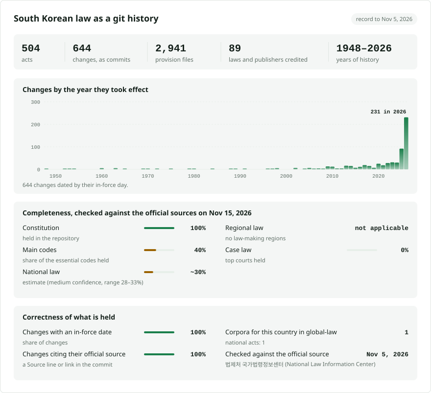

# South Korea: law history in git

[한국어](README.md) · **English**

<picture>
<source media="(prefers-color-scheme: dark)" srcset="data/effort-dark.svg">

</picture>

The law of South Korea as a git history: one file per article (one file per act for the acts held only in their current text), one commit per version on the day it took effect, and the law that made each change as the commit's author. `git blame` names the law behind every paragraph; `git log` lists every change to an article; picking a date gives the text in force that day.

Part of [lexifina/global-law](https://github.com/lexifina/global-law), one git history for every country's law: this is South Korea's national law, which global-law reads at `south-korea/national/acts/`.

**What is in it now:** four acts with their history, 98 versions from 17 July 1948: the Constitution (10 versions), the Civil Act (36), the Criminal Act (34) and the Personal Information Protection Act (18); and 500 more acts, 499 Acts and one presidential emergency order of 1952, each in the one text in force when it was retrieved on 5 November 2026: 504 acts and 598 versions in all. [`REPRODUCE.md`](REPRODUCE.md) lists every act with its folder and versions, and each act's folder has a `README.md` listing its provisions.

The four acts with history are folders by romanised name: `heonbeop/` is the 대한민국헌법 (Constitution), `minbeop/` the 민법 (Civil Act), `hyeongbeop/` the 형법 (Criminal Act) and `gaeinjeongbo-bohobeop/` the 개인정보 보호법 (Personal Information Protection Act). Each article is one file (`art-0001.md` is 제1조, `art-0007-02.md` 제7조의2), each paragraph one line; each 부칙 (supplementary provisions) is its own file and the headings are in `structure.md`. The other acts are one file each, `ls-<law.go.kr law ID>/text.md` (`ls-001565/` is the 소득세법, the Income Tax Act).

The text is in Korean, as law.go.kr publishes it, without its editorial notes (`<개정 ...>`, `[전문개정 ...]`). An English translation is not part of this record.

## Questions as git commands

| Question | Command |
| --- | --- |
| Every change to Article 1 of the Constitution | `git log -p --word-diff -- heonbeop/art-0001.md` |
| Which law wrote each line of Article 1? | `git blame heonbeop/art-0001.md` |
| Every version of the Constitution, with the day each took effect | `git log --grep="^In-force:" --format="%h %(trailers:key=In-force,valueonly,separator=) %an" -- heonbeop` |
| Article 1 as in force on 1 January 1960 | `python tools/on.py 1960-01-01 heonbeop art-0001` |

**Outside git**, we also host this record publicly, for free:

- **[Ask Claude about South Korean law](https://global-law.lexifina.com/v1/try_claude?country=south-korea)**: opens Claude with a first question ready.
- **[Ask ChatGPT](https://global-law.lexifina.com/v1/try_chatgpt?country=south-korea)**: the same question in ChatGPT.
- **[Search South Korean law on our site](https://lexifina.com/law?country=south-korea&q=%EC%9C%A0%EA%B8%89%ED%9C%B4%EA%B0%80)**: a search for "유급휴가" (paid leave), with each provision's text and its versions, no account needed.
- **[Developer REST API](https://global-law.lexifina.com/v1/search_law?query=%EC%9C%A0%EA%B8%89%ED%9C%B4%EA%B0%80&jurisdiction=south-korea)**: the same search as JSON, with no key. See the [documentation here](https://lexifina.com/api/global-law).

Both assistants read the record through the free Global law connector (MCP, `https://global-law.lexifina.com/mcp`); the first time, the chat gives you the link that adds it. Ask in Korean or in English.

**Host it yourself easily.** All it takes is git and Python, and the tools run on your machine:

```sh
git clone --depth 1 https://github.com/lexifina/global-law && cd global-law
python3 tools/countries.py add south-korea/national/acts
python3 tools/law.py show 2026-01-01 south-korea/national/acts/heonbeop/art-0001.md
```

Opened in Claude Code, Cursor, VS Code or Codex, the clone also starts a local MCP server with the same tools ([MCP.md](https://github.com/lexifina/global-law/blob/main/MCP.md)).

## Dates

Each commit is dated at noon, Asia/Seoul, on the day the version took effect, and carries it in its `In-force:` trailer:

- for the four acts with history, law.go.kr's own 시행일자 (in-force day) for each version, which already applies the law's 부칙 or the Constitution's default rule (a law takes effect 20 days after promulgation unless it provides otherwise, 헌법 제53조 제7항); where several laws take effect for one act on one day, the text is law.go.kr's version for the last of them;
- for the other acts, the day in the 시행 (commencement) header of the text, with its promulgation day and number in the commit message;
- git cannot store dates before 1970, so the 19 earlier commits are dated from 1970-01-01, one second apart, with the real day in `In-force:`. Ask for a date with `tools/on.py`, not `git log --before`.

Each change is credited to the law that made it, as law.go.kr names it (`법률 제19234호`, `헌법 제10호`), at an address that cannot exist (`law-19234@law.go.kr.invalid`), and only where law.go.kr's record shows that law made the change. Changes the record does not explain, including law.go.kr's re-spacing of old texts (띄어쓰기), are credited to the publisher, 법제처 국가법령정보센터 (43 of the 144 commits on the four acts), as is each of the 500 single texts; the committer is always Lexifina.

## How it is checked

- The text in force on 28 October 2026 of the four acts with history was compared with law.go.kr's page for that version, provision by provision, on 30 October 2026: no provision differs.
- `tools/check_repo.py` reads every version back from git on the day it took effect, and on the day before, and compares it with the corpus the history was built from (its sha256 is in `data/corpus.sha256`); it also checks that every commit's trailers parse, that `main` has no merge commits and that no date goes backwards. [`REPRODUCE.md`](REPRODUCE.md) says it has not yet been run on the current build.
- [`data/versions.json`](data/versions.json) gives each version's source address and sha256.
- History is append-only: the 500 further acts were added on top of the earlier history, and no published commit is rewritten.

## What it does not show

- **Earlier versions of the 500 further acts.** Each holds only its current text, credited to the publisher.
- **Most of South Korean law.** Other Acts, presidential decrees (시행령), ministerial rules (시행규칙), local ordinances (조례) and case law are not here.
- **Two versions of the Personal Information Protection Act not yet in force** (from 9 March and 1 July 2027): `REPRODUCE.md` and `data/versions.json` count them, but they are not in the history.
- **Annexes and forms (별표, 서식)**, and images in the source texts, are not in the files.
- **Constitutional Court decisions** voiding a provision: law.go.kr keeps the words and only adds a note, which is removed, so they are not commits.

## Sources

| Source | Kind | Past versions | Notes |
| --- | --- | --- | --- |
| [국가법령정보센터](https://www.law.go.kr) (National Law Information Center, 법제처 Ministry of Government Legislation) | Official law database: its Open API (each version by in-force day) and its law pages (the text in force) | yes, for the four acts with history; the current text only for the others | Editorial notes and amendment tags removed; spacing and quotation marks normalised |

## Licence

See [`LICENSE`](LICENSE). Statutes are not protected by copyright in Korea (저작권법 제7조); the text is from 법제처 국가법령정보센터, and the Government of Korea does not endorse this repository. Lexifina's history, commit messages and tools are CC0 1.0.

No model wrote, translated or corrected legal text, and no model runs when the history is built; the readers and builders were written with coding assistants (Claude Code and Codex) under Lexifina's direction (see [`REPRODUCE.md`](REPRODUCE.md)).

## More

From [lexifina/global-law](https://github.com/lexifina/global-law):

- [FEATURES.md](https://github.com/lexifina/global-law/blob/main/FEATURES.md): every feature, and what every corpus must support (`git blame`, `law.py`, the MCP tools)
- [FAQ.md](https://github.com/lexifina/global-law/blob/main/FAQ.md): questions and answers · [CONTRIBUTING.md](https://github.com/lexifina/global-law/blob/main/CONTRIBUTING.md): proposing changes · [MCP.md](https://github.com/lexifina/global-law/blob/main/MCP.md): the MCP server · [REPRODUCE.md](https://github.com/lexifina/global-law/blob/main/REPRODUCE.md): how it was built · [CHANGELOG.md](https://github.com/lexifina/global-law/blob/main/CHANGELOG.md)
- [FRESHNESS.md](https://github.com/lexifina/global-law/blob/main/FRESHNESS.md): how current each corpus is · [Monitoring](https://github.com/lexifina/global-law/tree/main/monitoring): whether updates are running · [WATCHING.md](https://github.com/lexifina/global-law/blob/main/WATCHING.md): how each official source is watched for changes
- [performance/](https://github.com/lexifina/global-law/tree/main/performance): how fast the tools are, measured
- [visualisations/](https://github.com/lexifina/global-law/tree/main/visualisations): charts and bridges across the world's law
- [Vulnerabilities](https://github.com/lexifina/global-law/tree/main/vulnerabilities): mistakes in legislation as published
