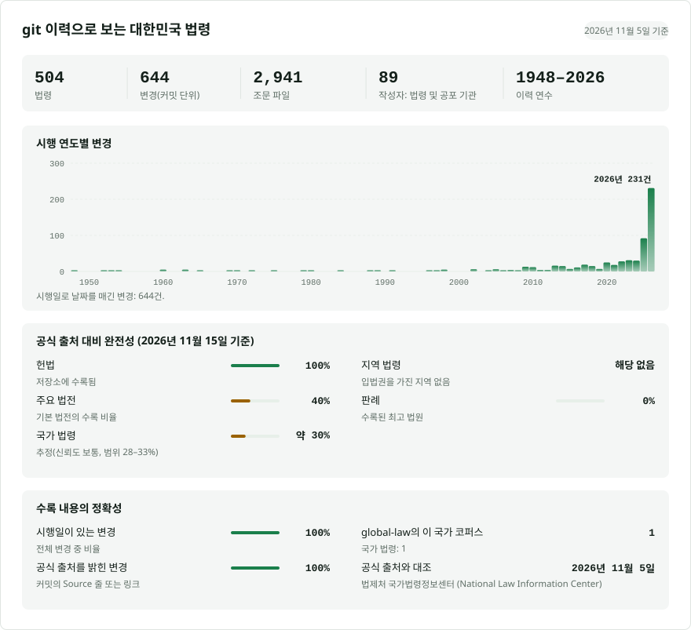

# 대한민국: git으로 보는 법령 연혁

**한국어** · [English](README.en.md)

<picture>
<source media="(prefers-color-scheme: dark)" srcset="data/ko/effort-dark.svg">

</picture>

대한민국 법령을 git 이력으로 만든 것입니다. 조문마다 하나의 파일, 판마다 시행일 날짜의 커밋 하나로 하고, 해당 변경을 한 법령을 커밋의 작성자(author)로 합니다. `git blame`은 모든 항에 대해 그것을 쓴 법령을 보여 주고, `git log`는 조문의 모든 변경을 나열하며, 날짜를 고르면 그날 시행 중이던 본문을 얻을 수 있습니다.

[lexifina/global-law](https://github.com/lexifina/global-law)(모든 나라의 법령을 하나의 git 이력으로 모은 것)의 일부입니다. 이 저장소는 대한민국의 국가 법령이며, global-law는 이를 `south-korea/national/acts/`에서 읽습니다.

**현재 수록 내용:** 헌법과, 법령마다 차례로, 국가법령정보센터에 현행으로 올라 있는 모든 법률, 대통령령, 총리령·부령과 헌법기관의 규칙(2026년 11월 27일 현재 5,634건)을 1948년 7월 17일부터 국가법령정보센터가 제공하는 시행일별 모든 판과 함께 수록합니다. 기본 법전(민사소송법, 형사소송법, 상법, 근로기준법, 행정기본법 등)을 먼저, 그다음 나머지 법률, 대통령령, 부령의 순서로 구축하며, 2026-11-27 현재 연혁을 모두 갖춘 법령 19건(488개 판)을 수록하고 있습니다. 이전 빌드의 그 밖의 법령은 구축이 그 법령에 이를 때까지 현행 본문 하나만 수록합니다. 구성은 [`STRUCTURE.md`](STRUCTURE.md)에 있으며, 각 법령의 폴더에 있는 `README.md`는 그 판을 나열합니다.

폴더는 종류와 제정 공포연도에 따른 한국어 이름입니다. `헌법/`, `법률/<연도>/<법령명>/`(`법률/1958/민법/`은 민법), `대통령령/<연도>/<법령명>/`(시행령), `부령/<연도>/<법령명>/`(총리령과 부령, 시행규칙), 그리고 법원과 그 밖의 헌법기관의 규칙은 그 종류의 이름 아래(`대법원규칙/` 등)에 있습니다. 조문마다 하나의 파일(`art-0001.md`는 제1조, `art-0007-02.md`는 제7조의2), 항마다 한 줄이며, 부칙은 각각 별도의 파일이고 제목은 `structure.md`에 있습니다. 아직 다시 구축하지 않은 이전 빌드의 법령은 하나의 파일 `text.md`입니다.

본문은 국가법령정보센터(law.go.kr)가 게시한 한국어 그대로이며, 편집 주석(`<개정 ...>`, `[전문개정 ...]`)은 제외했습니다. 영어 번역은 이 기록에 포함되지 않습니다.

## git 명령으로 답하는 질문

| 질문 | 명령 |
| --- | --- |
| 헌법 제1조의 모든 변경 | `git log -p --word-diff -- 헌법/art-0001.md` |
| 제1조의 각 줄은 어느 법령이 썼는가? | `git blame 헌법/art-0001.md` |
| 헌법의 모든 판과 각각의 시행일 | `git log --grep="^In-force:" --format="%h %(trailers:key=In-force,valueonly,separator=) %an" -- 헌법` |
| 1960년 1월 1일 당시 시행 중이던 제1조 | `python tools/on.py 1960-01-01 헌법 art-0001` |

**git 밖에서도** 이 기록을 무료로 공개하고 있습니다.

- **[대한민국 법령에 대해 Claude에게 묻기](https://global-law.lexifina.com/v1/try_claude?country=south-korea)**: 첫 질문이 준비된 상태로 Claude를 엽니다.
- **[ChatGPT에게 묻기](https://global-law.lexifina.com/v1/try_chatgpt?country=south-korea)**: 같은 질문을 ChatGPT에서 합니다.
- **[우리 사이트에서 대한민국 법령 검색](https://lexifina.com/law?country=south-korea&q=%EC%9C%A0%EA%B8%89%ED%9C%B4%EA%B0%80)**: "유급휴가" 검색 결과를 각 조문의 본문 및 그 판과 함께 보여 줍니다. 계정은 필요하지 않습니다.
- **[개발자용 REST API](https://global-law.lexifina.com/v1/search_law?query=%EC%9C%A0%EA%B8%89%ED%9C%B4%EA%B0%80&jurisdiction=south-korea)**: 같은 검색을 JSON으로 제공하며, 키가 필요하지 않습니다. [여기에서 문서](https://lexifina.com/api/global-law)를 보십시오.

두 어시스턴트 모두 무료 Global law 커넥터(MCP, `https://global-law.lexifina.com/mcp`)를 통해 이 기록을 읽습니다. 처음 사용할 때는 채팅에 커넥터를 추가하는 링크가 표시됩니다. 질문은 한국어나 영어로 하시면 됩니다.

**직접 쉽게 호스팅할 수 있습니다.** git과 Python만 있으면 되며, 도구는 사용자의 컴퓨터에서 실행됩니다.

```sh
git clone --depth 1 https://github.com/lexifina/global-law && cd global-law
python3 tools/countries.py add south-korea/national/acts
python3 tools/law.py show 2026-01-01 south-korea/national/acts/헌법/art-0001.md
```

Claude Code, Cursor, VS Code 또는 Codex에서 열면, 이 클론은 같은 도구를 갖춘 로컬 MCP 서버도 시작합니다([MCP.md](https://github.com/lexifina/global-law/blob/main/MCP.md)).

## 날짜

각 커밋의 날짜는 해당 판이 시행된 날의 정오(Asia/Seoul)이며, 그날을 `In-force:` 트레일러에 기록합니다.

- 모든 법령은 판마다 국가법령정보센터 자체의 시행일자를 사용합니다. 이 시행일자에는 이미 해당 법령의 부칙 또는 헌법의 기본 규칙(법률은 특별한 규정이 없으면 공포한 날부터 20일을 경과함으로써 효력을 발생한다, 헌법 제53조 제7항)이 반영되어 있습니다. 한 법령에 대해 여러 법령이 같은 날 시행되는 경우, 본문은 그중 마지막 법령에 대한 국가법령정보센터의 판입니다.
- 각 판의 시행일은 국가법령정보센터 연혁 목록의 것이며, 커밋의 `In-force-basis:` 트레일러에 그대로 인용하고, 공포일과 공포번호는 `Published:`와 `Law:`에 적습니다. 아직 시행되지 않은 판은 시행일까지 보류합니다.
- git은 1970년 이전의 날짜를 저장할 수 없으므로, 그 이전의 커밋은 1970-01-01로 날짜를 매기고 실제 날짜는 `In-force:`에 기록합니다. 날짜를 지정한 조회는 `git log --before`가 아니라 `tools/on.py`로 하십시오.

각 변경은 국가법령정보센터가 부르는 이름(`법률 제19234호`, `헌법 제10호`)으로 그 변경을 한 법령의 명의로 하고, 존재할 수 없는 주소(`law-19234@law.go.kr.invalid`)를 사용하며, 이는 국가법령정보센터의 기록상 그 법령이 해당 변경을 했다고 나타나는 경우에 한합니다. 기록이 설명하지 않는 변경(국가법령정보센터가 옛 본문의 띄어쓰기를 고친 것 포함)은 게시자인 법제처 국가법령정보센터의 명의로 하며(4개 법령의 커밋 144개 중 43개), 단일 본문 500건도 마찬가지입니다. 커미터는 항상 Lexifina입니다.

## 검증 방법

- 연혁을 갖춘 법령 4건의 2026년 10월 28일 당시 시행 본문을, 2026년 10월 30일에 해당 판의 국가법령정보센터 페이지와 조문별로 비교했습니다. 다른 조문은 없습니다.
- `tools/check_repo.py`는 모든 판을 시행일과 그 전날 기준으로 git에서 다시 읽어, 이력을 구축한 원본 코퍼스(그 sha256은 `data/corpus.sha256`에 있음)와 비교합니다. 또한 모든 커밋의 트레일러를 해석할 수 있는지, `main`에 병합 커밋이 없는지, 날짜가 거꾸로 가지 않는지도 확인합니다. [`REPRODUCE.md`](REPRODUCE.md)에 따르면 현재 빌드에는 아직 실행되지 않았습니다.
- [`data/versions.json`](data/versions.json)은 각 판의 출처 주소와 sha256을 제공합니다.
- 이력은 추가만 합니다. 추가 법령 500건은 기존 이력 위에 추가되었고, 2026년 11월 27일 평면 폴더를 한 번의 순수한 이름 변경 커밋으로 한국어 구성으로 옮겼으며, 각 법령의 전체 연혁은 그 위에 추가되어 가장 오래된 판이 단일 본문을 대신합니다. 공개된 커밋은 다시 쓰지 않습니다.
- [vulnerabilities/](vulnerabilities/): 이 법령에 있을 수 있는 입법 기술상의 오류. global-law 검출기로 찾고 사람이 직접 확인합니다. 아직 실행하지 않았습니다.

## 보여 주지 않는 것

- **구축이 아직 이르지 않은 법령.** 그때까지 이전 빌드의 법령은 현행 본문 하나만 수록하고, 그 밖의 현행 법령은 빠져 있습니다.
- **폐지된 법령**(국가법령정보센터에서 현행이 아닌 법령), 자치법규(조례), 행정규칙과 판례는 여기에 없습니다.
- **아직 시행되지 않은 개인정보 보호법의 두 판**(2027년 3월 9일 및 7월 1일 시행): `REPRODUCE.md`와 `data/versions.json`은 이를 집계하지만, 이력에는 들어 있지 않습니다.
- **별표·서식** 및 원문의 이미지는 파일에 들어 있지 않습니다.
- 조문을 무효로 하는 **헌법재판소 결정**: 국가법령정보센터는 문언을 그대로 두고 주석만 덧붙이는데, 이 주석은 제거되므로 커밋이 되지 않습니다.

## 출처

| 출처 | 종류 | 과거 판 | 비고 |
| --- | --- | --- | --- |
| [국가법령정보센터](https://www.law.go.kr) (법제처) | 공식 법령 데이터베이스: Open API(처음 4건의 시행일별 각 판)와 공개 법령 페이지: 현행법령 목록(lsSc.do), 법령별 연혁 목록(lsHstListR.do), 시행일별 본문(lsInfoR.do) | 있음: 국가법령정보센터가 제공하는 모든 판 | 편집 주석과 개정 표시는 제거함. 처음 4건은 띄어쓰기와 따옴표를 정규화하고, 그 밖의 법령은 게시된 그대로 |

## 라이선스

[`LICENSE`](LICENSE)를 보십시오. 대한민국에서 법령은 저작권의 보호를 받지 못합니다(저작권법 제7조). 본문은 법제처 국가법령정보센터의 것이며, 대한민국 정부는 이 저장소를 보증하지 않습니다. Lexifina의 이력, 커밋 메시지와 도구는 CC0 1.0입니다.

어떤 모델도 법령 본문을 쓰거나 번역하거나 수정하지 않았으며, 이력을 구축할 때 어떤 모델도 실행되지 않습니다. 읽기 프로그램과 구축 프로그램은 Lexifina의 지시에 따라 코딩 어시스턴트(Claude Code와 Codex)로 작성했습니다([`REPRODUCE.md`](REPRODUCE.md) 참조).

이 문서는 영어판([README.en.md](README.en.md))의 번역본입니다. 내용이 다를 경우 영어판이 우선합니다.

## 시각화

- [visualisations/](visualisations/): 이 저장소로 그린 차트. 아직 그리지 않았습니다.

## 더 알아보기

[lexifina/global-law](https://github.com/lexifina/global-law) 저장소에서(영어 페이지):

- [FEATURES.md](https://github.com/lexifina/global-law/blob/main/FEATURES.md): 모든 기능과 각 코퍼스가 지원해야 하는 사항(`git blame`, `law.py`, MCP 도구)
- [FAQ.md](https://github.com/lexifina/global-law/blob/main/FAQ.md): 자주 묻는 질문 · [CONTRIBUTING.md](https://github.com/lexifina/global-law/blob/main/CONTRIBUTING.md): 변경 제안 · [MCP.md](https://github.com/lexifina/global-law/blob/main/MCP.md): MCP 서버 · [REPRODUCE.md](https://github.com/lexifina/global-law/blob/main/REPRODUCE.md): 구축 방법 · [CHANGELOG.md](https://github.com/lexifina/global-law/blob/main/CHANGELOG.md)
- [FRESHNESS.md](https://github.com/lexifina/global-law/blob/main/FRESHNESS.md): 각 코퍼스가 얼마나 최신인지 · [모니터링](https://github.com/lexifina/global-law/tree/main/monitoring): 업데이트가 정상적으로 실행되는지 · [WATCHING.md](https://github.com/lexifina/global-law/blob/main/WATCHING.md): 각 공식 출처의 변경을 감시하는 방법
- [performance/](https://github.com/lexifina/global-law/tree/main/performance): 도구의 속도 측정 결과
- [visualisations/](https://github.com/lexifina/global-law/tree/main/visualisations): 전 세계 법을 가로지르는 차트와 연결
- [취약점](https://github.com/lexifina/global-law/tree/main/vulnerabilities): 공포된 법령 자체에 있는 오류
